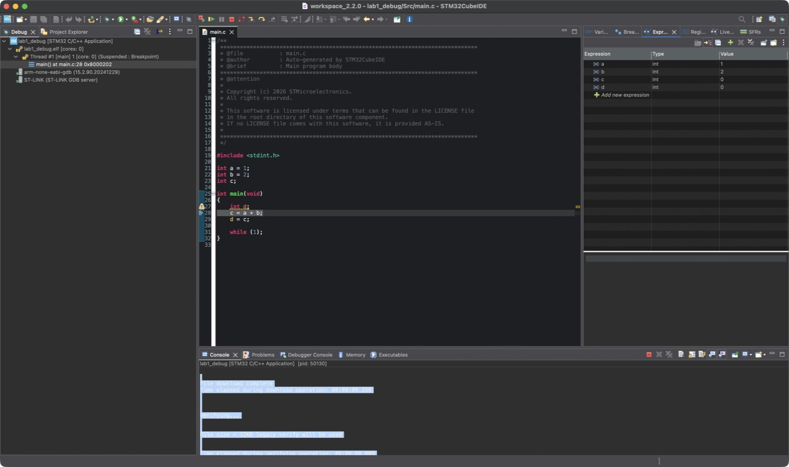
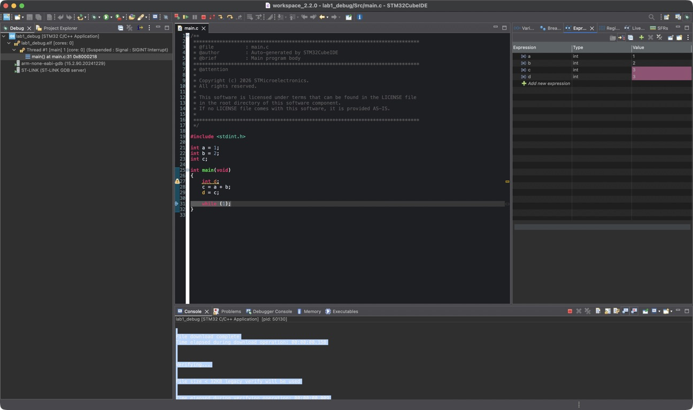

# EE186 Lab 1: Hello, World!

## Part 2. Flashing & Debugging Code

### a)

Flashing builds the program, erases the required flash pages, writes the program, and verifies the download. New build files appear inside `Debug/`, including `lab1_debug.elf`, `lab1_debug.list`, and `Src/main.o` (also `part2-flashing-and-debugging-code/part2.o` after reorganizing the code).

The compiled program is written to the MCU's internal flash memory and is retained when power is off.

STM32CubeIDE communicates with the board through USB connected from my Mac and the onboard ST-LINK debugger.

The onboard ST-LINK programmer/debugger transfers the compiled program to the microcontroller.

### b)

Before the assignments: `a = 1`, `b = 2`, `c = 0`. The debugger displays `d = 0`, but `d` is uninitialized.

After the assignments: `a = 1`, `b = 2`, `c = 3`, `d = 3`. These values remain unchanged in the infinite loop.

## Part 3. Blinking LEDs

### a)

The board has three user LEDs: LD1 (green), LD2 (blue), and LD3 (red).

The pins are PC7 for green, PB7 for blue, and PB14 for red in the lab configuration.

We configure these pins as GPIOs. This means each pin can be set to read a digital signal as an input or send a high or low signal as an output. We're pretty much trying to observe these LED outputs.

They should be outputs because the MCU sends signals to the LEDs. A high signal turns an LED on, and a low signal turns it off.

### b)

Pending: capture the RCC register values after enabling the GPIO clocks and save the image in `part3-blinking-leds/screenshots/`.

### c)

Pending: implement the green/blue/red blinking sequence and save the demonstration video in `part3-blinking-leds/videos/`.

## Part 4. Blinking LED in Assembly

Pending: implement and verify the inline-assembly program that turns on the blue LED.

## Assistance

I used AI assistance to set up the project repo, laying out the different parts and setting up the README.md so that I can easily input my actual responses. I also used it to help understand some of these concepts and also help direct me on where to look inside the manuals since they were very big.
